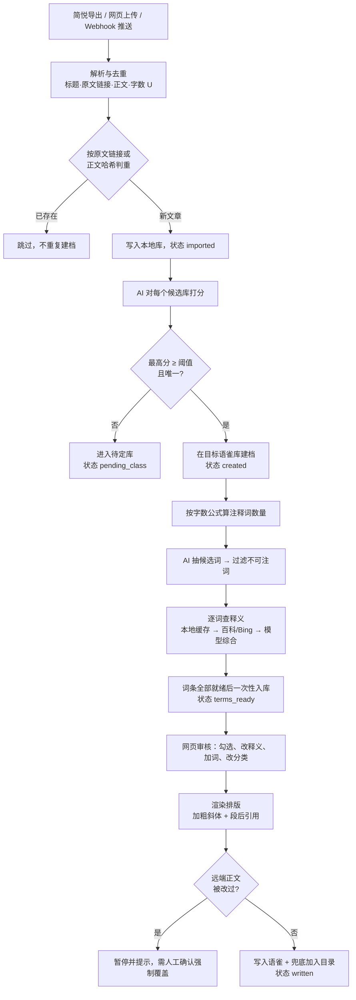
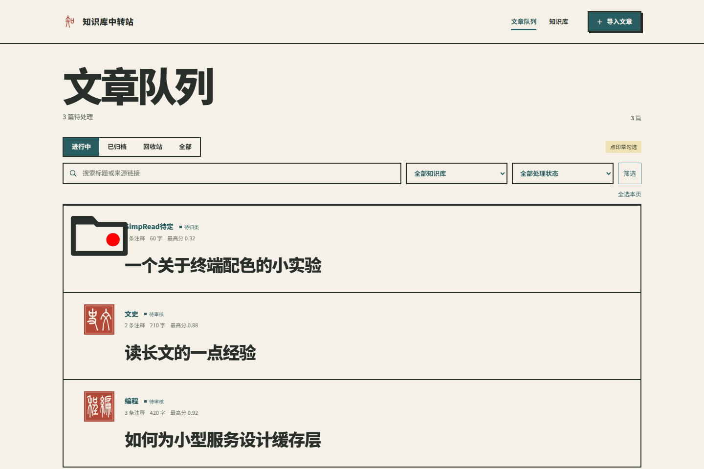
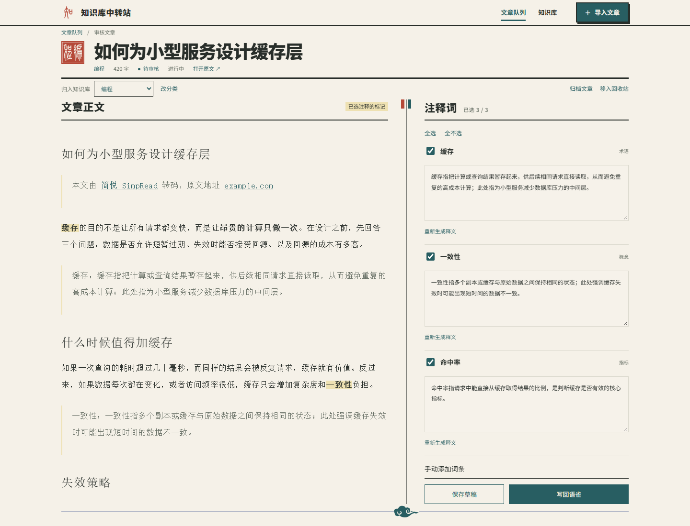

# 语雀知识库中转站（yuque-knowledge-relay）

把网页文章自动归类到你自己的语雀知识库，并为其中值得解释的名词生成注释草稿；人工确认后，按固定排版规则写回语雀。

一句话概括流程：**导入文章 → AI 判断属于哪个库 → 在语雀建档 → 抽取候选注释词 → 联网查释义 → 人工审核勾选 → 写回语雀**。

> 版本：v1.0.0　许可证：MIT　语言：Go 1.27

---

## 这个工具解决什么问题

如果你用「稍后读」类工具（例如简悦 SimpRead）收集文章，再手工搬进语雀，通常会遇到三件麻烦事：

1. **分库靠人脑**：十几个库，每篇文章都要想「这该放哪」，容易犹豫、也容易放错。
2. **名词注释靠手工**：读专业文章时想给术语加注解，要一个个查、一个个写，很费时间。
3. **格式容易乱**：手工在正文里加粗、在段后写解释，稍不注意就破坏原文排版。

本工具把这三件事变成一条流水线：AI 只负责「判断和建议」，最终是否写回、写哪些词，仍然由你在网页上勾选确认。

## 适合谁

- 用语雀做长期知识库，库很多、分类边界细的人。
- 习惯用浏览器阅读并保存长文，愿意花几分钟审核注释的人。
- 想自己部署、自己掌控数据的人（文章、释义、状态都存在本地 SQLite）。

## 不适合谁

- 想全自动、不审核就写回的人。写回会改动你在语雀里的正文，本项目刻意保留人工确认这一步。
- 没有语雀账号或不愿配置语雀 API Token 的人。
- 需要多人协作、权限管理、审计日志的团队场景。v1.0 是单用户本机/单机部署形态，**没有内置登录与鉴权**。

---

## 处理流程



更细的字段、状态机与分支见 [docs/PIPELINE.md](docs/PIPELINE.md)。

---

## 主要界面

### 文章队列



列表展示标题、所属库与得分、阅读字数、候选词勾选数、处理状态和保留状态；顶部是导入区与批次进度，下面是筛选、批量操作和分页。

### 文章审核



左边是套用排版规则后的正文预览（被选中的注释词会高亮，段后显示引用块），右边是注释词卡片：勾选、修改释义、重新生成、手动加词。中间那条把手可以上下拖动调整两栏高度，也能左右拖动改变宽度。

### 知识库设置


每个库可以调整「候选词倍率」，也可以直接编辑该库的分类档案（档案全文就是分类提示词）。

> 截图中的标题、作者、来源域名、语雀空间与库标识均为示例数据，不对应任何真实账号或文章。

---

## 快速开始

### 1. 准备环境

- Go 1.27 或更高版本
- 一个语雀账号，以及语雀开放 API 的 Token
- 一个 OpenAI 兼容的大模型接口（分类和释义各用一个模型）

### 2. 取代码与编译

```bash
git clone https://github.com/<你的账号>/yuque-knowledge-relay.git
cd yuque-knowledge-relay/goapp
go build -o ../knowledge-relay .
```

编译产物是一个单文件可执行程序，运行时不依赖 Go 环境。

### 3. 放配置

在项目根目录创建 `config.yaml`（可直接复制 `config.example.yaml`），填写语雀 Token、模型地址与模型名、以及你的库列表：

```yaml
yuque:
  token: ""                       # 建议留空，放到 .env 的 YUQUE_TOKEN
  base_url: "https://www.yuque.com/api/v2"
  pending_library: "待定"          # 无法分类的文章落到这个库

llm:
  base_url: "https://api.openai.com/v1"
  api_key: ""                     # 建议放 .env 的 LLM_API_KEY
  classify_model: "你的分类模型"
  explain_model: "你的释义模型"

libraries:
  - {name: 技术, namespace: 你的空间, slug: 你的库标识, multiplier: 1.0}
  - {name: 待定, namespace: 你的空间, slug: 你的待定库标识, multiplier: 1.0}
```

密钥建议写进同目录的 `.env`：

```
YUQUE_TOKEN=...
LLM_API_KEY=...
```

程序启动时会读取 `.env`，已存在的环境变量优先。

### 4. 准备分类档案

分类靠的是「每个库一份 Markdown 档案」。`profiles/` 里附带了本项目的 15 份档案示例，可以直接改，也可以按同样结构自己写：

```markdown
## 定位
一句话说明这个库收什么。

## 收录范围
- 3 到 8 条具体主题与体裁。

## 典型主题
关键词或短语，用顿号分隔。

## 边界与排除
- 与相邻库怎么区分，写清「谁归谁」。

## 主次判断与评分
给出 0.80~1.00、0.50~0.79、0.20~0.49、0~0.19 四档的判据。
```

档案文件名必须与 `config.yaml` 里的库名一致（`profiles/技术.md` 对应 `name: 技术`）。

### 5. 启动

```bash
cd goapp                    # 模板按相对路径读取，必须在 goapp 目录下启动
../knowledge-relay -addr 127.0.0.1:8010 -root ..
```

打开 `http://127.0.0.1:8010`。首次启动会自动建库建表，并把输入目录、归档目录准备好。

### 6. 导入第一篇文章

三种方式任选：

- **放进收件箱**：把 `.md` / `.html` 放进 `inbox/`，点页面上的「扫描收件箱」。
- **网页上传**：页面顶部的「选择文件 → 上传并处理」。
- **简悦 Webhook**：见下一节。

导入后页面会出现批次进度条，处理完成后文章出现在「待审核」。

### 7. 审核并写回

点开一篇文章：

1. 看左边的预览，确认注释词位置是否合适；
2. 在右边取消不需要的词、修改释义，或手动加词；
3. 点「确认并写回语雀」。

如果这篇是第一次写回，程序会先在目标库建文档再更新；如果远端正文在你上次写回之后被改过，会停下来提示，需要你确认「强制覆盖远端」才会继续。

---

## 接入简悦（SimpRead）

1. 打开简悦设置 → 服务 → Webhook。
2. 把 `scripts/simpread-webhook.example.json` 里的 URL 改成你的地址，`X-Ingest-Key` 换成你自己的随机串。
3. 在简悦里触发导出，正文会以 HTML 形式 POST 到 `/ingest/simpread`，落到 `inbox/` 并自动开始处理。

如果需要从其他设备推送，仓库里还有一份 Tampermonkey 用户脚本模板 `scripts/simpread-kb-relay.user.js`，把 `ENDPOINT` 和 `INGEST_KEY` 换成你自己的即可。

> 提醒：v1.0 的 Go 服务本身**不校验** `X-Ingest-Key`，这个头只是给前置反向代理做鉴权用的。请务必按 [docs/DEPLOY.md](docs/DEPLOY.md) 放在需要认证的入口后面，否则任何人都能往你的收件箱推送文章。

---

## 配置项说明

| 配置 | 作用 | 默认 |
|---|---|---|
| `yuque.token` | 语雀开放 API Token | 空 |
| `yuque.pending_library` | 待定库名称，无法分类时落到这里 | `SimpRead待定` |
| `llm.classify_model` | 分类用的模型 | 必填 |
| `llm.explain_model` | 释义用的模型 | 必填 |
| `limits.density` | 每千字推荐几个注释词 | `2.5` |
| `limits.floor` / `hard_cap` | 推荐数量下限 / 上限 | `3` / `14` |
| `classify.threshold` | 分类置信度阈值 | `0.5` |
| `classify.body_chars` | 分类时送入正文的最大字数 | `3000` |
| `explain.online` | 是否联网查百科与搜索 | `true` |
| `explain.proxy` | 联网查询走的代理，留空为直连 | 空 |
| `retention.auto_archive_written` | 写回成功后自动归档本地记录 | `false` |

注释词数量公式：`clamp(ceil(字数U / 1000 × density × 库倍率), floor, hard_cap)`。库倍率可以在网页上按库单独调。

---

## 安全须知

- 本项目**没有内置登录**。直接暴露到公网等于把你的语雀写入能力公开，请务必放在带认证的反向代理后面，或只监听本机。
- 所有密钥只从 `config.yaml` 或 `.env` 读取，**不要提交到仓库**。仓库自带的 `.gitignore` 已排除 `.env`、`config.yaml`、数据库和日志。
- 写回会整篇替换语雀文档正文。远端被改过时程序会停下来，请先看清提示再决定是否强制覆盖。

---

## 文档目录

| 文档 | 内容 |
|---|---|
| [docs/PIPELINE.md](docs/PIPELINE.md) | 全流程、状态机、批次与写回队列、冲突处理 |
| [docs/API.md](docs/API.md) | 所有 HTTP 接口与命令行参数 |
| [docs/DESIGN.md](docs/DESIGN.md) | 技术实现：数据表、分类、抽词、释义、排版规则 |
| [docs/DEPLOY.md](docs/DEPLOY.md) | systemd + Nginx 部署示例（含认证配置） |
| [docs/FAQ.md](docs/FAQ.md) | 常见问题与排错 |

## 目录结构

```
goapp/                     Go 源码（单一 main 包）
  main.go                  入口、路由注册、页面数据
  config.go                配置加载与环境变量覆盖
  db.go                    表结构与增量补列
  ingest.go                解析、标题与链接归一化、正文哈希
  classify.go              库档案加载、打分提示词、分数校验
  terms.go                 候选词抽取、可注性过滤与排序
  explain.go               释义：缓存 → 百科/Bing → 模型综合
  render.go                排版硬规则渲染
  pipeline.go              建档与写回
  pipeline_ai.go           导入、分类、抽词、重试、超时收口
  writequeue.go            写回队列（跨重启）
  routes_post.go           批量、上传、扫描、进度
  templates/               页面模板
  testdata/                测试样例
app/static/                静态资源（样式、图标、印章、字体）
profiles/                  每个库一份分类档案
scripts/                   简悦 Webhook 与用户脚本模板
docs/                      设计与部署文档
```

## 许可证

MIT，见 [LICENSE](LICENSE)。第三方资源（Noto Sans SC 字体、Go 依赖）的授权见 [THIRD_PARTY_NOTICES.md](THIRD_PARTY_NOTICES.md)。
